# Informe da tarefa "Tolerancia a fallos" | Parte A

Tras arrancar os tres nodos con `docker compose up -d`, iniciouse o réplica set (`docker compose exec mongo1 mongosh /scripts/iniciar_re.js`) e consultouse o estado dos nodos.

Estado dos nodos:

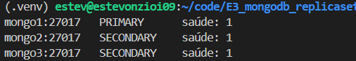

Obsérvase que os tres están en bo estado (saúde) e que *mongo1* é o primario. 

*Mongo2* e *mongo3* son secundarios; a diferenza respecto á demo de Sentinel é que aquí só temos como servizos os tres nodos (mongo1, mongo2 e mongo3), e non precisan de ningún servizo que os supervise, de feito, poden intercambiar información entre eles sobre o seu estado e elixir un novo primario. Na demo de Sentinel, os servizos de Redis sí precisaban ter servizos independentes de Sentinel (normalmente tres) que se encargan da súa supervisión.

A continuación, mediante o seguinte comando:

`docker compose exec mongo1 mongosh "mongodb://mongo1,mongo2,mongo3/?replicaSet=rs0" /scripts/fichas.js`

cargáronse as fichas conectándose ao réplica set `rs0` e utilizando os tres nodos como puntos de conexión. 

As fichas cargáronse dentro da base de datos `albergues`. Comprobamos que se cargaron as seis fichas dentro desta base:

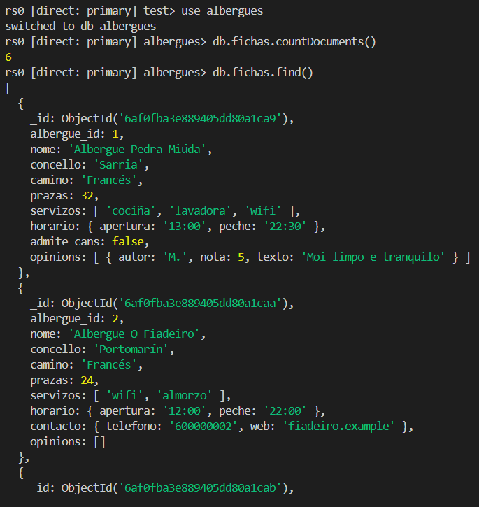

A diferenza respecto á demo de Sentinel é que na réplica set de mongo, os nodos comunícanse entre eles. Cando o nodo primario recibe unha actualización, comunícallo aos outros nodos para que se actualicen tamén. Nun desplegue de Redis, o cliente debe consultar a un Sentinel cál é o nodo primario; sen embargo, en MongoDB, o cliente pode saber se un nodo é primario conectándose a él segundo o nome dos nodos que aparecen no replica set.

## Lectura e escritura nos secundarios

Partimos desta disposición dos nodos: O primario é Mongo3 e podemos identificar aos nodos cos seguintes IDs:

- Mongo1: fb5d6e148fe5
- Mongo2: 6137ce4fe4c3
- Mongo3 (PRIMARIO): 0c415d862893

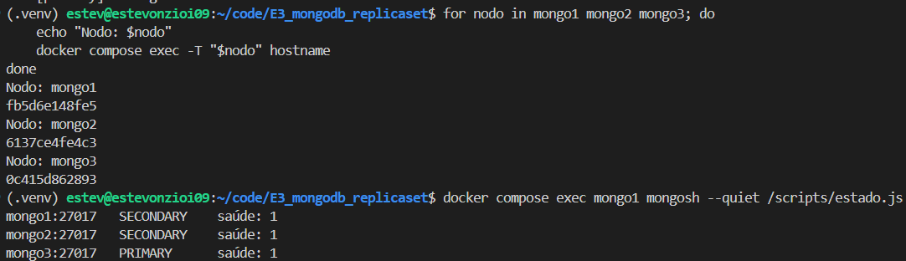

Intentamos engadir unha ficha dende Mongo2, pero como era de esperar non nos deixa por non ser o nodo primario:

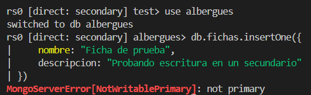

Entramos de novo na base de datos pero dende o replicaset e facemos as seguintes peticións:

- Que nos mostre a información do host que pode ler as fichas: `db.fichas.find().explain().serverInfo.host`
- Que se lle asigne a lectura ao nodo secundario: `db.getMongo().setReadPref("secondary")`
- Que nos volva a mostrar a información do host: `db.fichas.find().explain().serverInfo.host`

Observamos o seguinte:

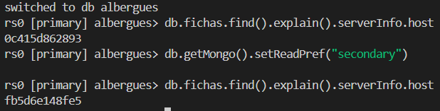

A primeira vez, o nodo primario (Mongo3) foi o que leu a consulta das fichas. Despois da asignación a un nodo secundario da lectura das consultas, aparece o ID de Mongo1 (un dos nodos secundarios) ao repetir a orde anterior.

### Vantaxes e riscos de ler dende os secundarios

A principal vantaxe é a optimización dos recursos. Outorgarlle a un nodo secundario a capacidade de ler permite ter ao nodo primario con menor sobrecarga e centrado noutras funcións, como a da escritura e o borrado.

O principal inconveniente son os potenciais retardos á hora de consultar a información que xusto acaba de entrar polo nodo primario e que aínda non tivo tempo de pasar aos secundarios. Isto xeneraría lecturas obsoletas e crear confusión.

## Caída do primario

## Caída de dous nodos

## Cuestións

# E3. Garage: almacenamento de obxectos | Parte B

## 1. Formación do clúster (B1)

## 2. Definición do layout (B2)

## 3. Bucket, clave e primeiros datos (B3)

Creouse o bucket albergues-docs e a clave de acceso e3-clave, á que se lle concederon permisos de lectura, escritura e propiedade sobre o bucket.

A continuación, instalouse a biblioteca boto3 e cargáronse 20 documentos de 512 KB cada un. A operación completouse correctamente en aproximadamente 2 segundos.

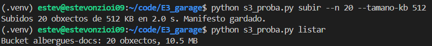

A verificación posterior confirmou que os 20 obxectos se puideron descargar correctamente e que ningún presentaba corrupción.

## 4. Cae un nodo
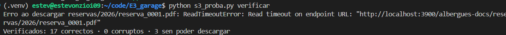
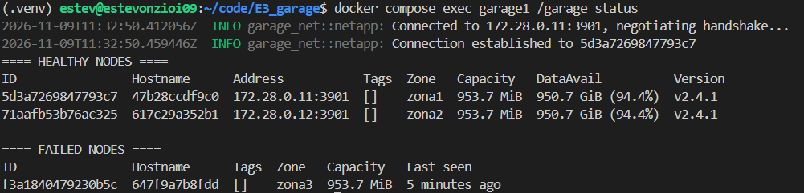
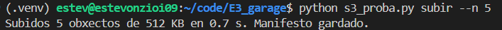

## 5. Caen dous nodos
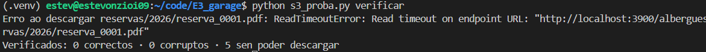
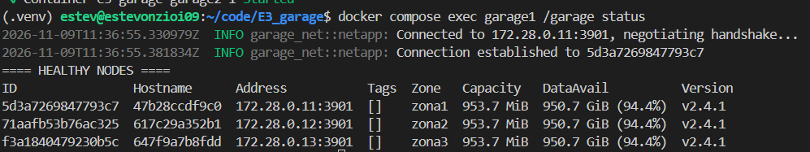
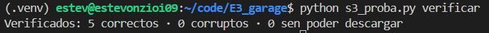

### Interpretación do quorum

Interpretación do quórum
Para redactar o informe, podemos destacar estas diferenzas:
- Garage: replica os datos entre os tres nodos. Con dous nodos activos puidemos subir documentos, pero algunhas lecturas fallaron. Cun único nodo activo non se puideron completar as descargas, comportamento compatible coa necesidade de contar con suficientes réplicas dispoñibles.
- MongoDB Replica Set: necesita unha maioría dos membros votantes para elixir e manter un Primary. Nun conxunto de tres membros, esa maioría é de dous. Cun só membro non pode manter o Primary.
- Redis Sentinel: os Sentinel supervisan os nodos Redis e utilizan quórum e maioría para autorizar un failover. Cómpre distinguir isto da replicación dos datos: Sentinel non almacena nin replica os datos, senón que supervisa e coordina a recuperación.

## Perda dun disco

Simulouse a perda do disco do nodo 3 e a súa substitución por un volume novo e baleiro, mantendo o volume de metadatos para conservar a identidade do nodo.

Antes da eliminación, comprobouse o tamaño que ocupaba o volume do nodo 3:

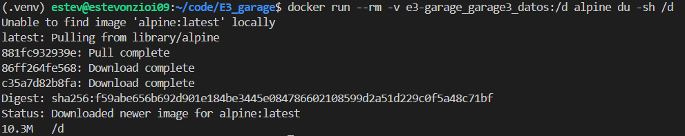

Despois detívose o nodo 3 e eliminouse o seu volume de datos, mantendo intacto o volume de metadatos. Volveuse a comprobar o tamaño e, como se pode ver, pasou de 10,3 MB a tan só 4 KB.

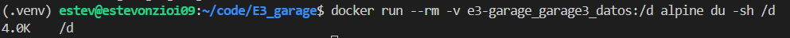

#### Pequena incidencia

Inicialmente, o nodo non puido arrancar porque Garage non atopaba o ficheiro identificador `garage-marker` no novo volume. Grazas a que conservamos os metadatos, puidemos recuperar o identificador do disco anterior e restaurar o ficheiro marcador. 

O nodo 3 puido arrancarse e conectarse cos outros nodos. Comprobouse se dende este nodo tiñamos acceso aos arquivos. Observouse que sí que tiñamos ese acceso.

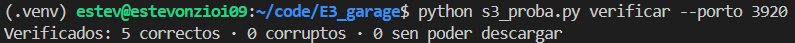

Despois executouse o seguinte comando para ordenar a reparación dos bloques: 

`docker compose exec garage3 /garage repair --yes blocks`

Tras a execución, esperamos que o volume da datos do nodo 3 volva a ter 10,3 MB. Comprobouse que así era:

