# Informe da tarefa "Tolerancia a fallos" | Parte A

### Autor: Estevo Arias García

Tras arrancar os tres nodos con `docker compose up -d`, iniciouse o réplica set (`docker compose exec mongo1 mongosh /scripts/iniciar_re.js`) e consultouse o estado dos nodos.

Estado dos nodos:


Obsérvase que os tres están en bo estado (saúde) e que *mongo1* é o primario. 

*Mongo2* e *mongo3* son secundarios; a diferenza respecto á demo de Sentinel é que aquí só temos como servizos os tres nodos (mongo1, mongo2 e mongo3), e non precisan de ningún servizo que os supervise, de feito, poden intercambiar información entre eles sobre o seu estado e elixir un novo primario. Na demo de Sentinel, os servizos de Redis sí precisaban ter servizos independentes de Sentinel (normalmente tres) que se encargan da súa supervisión.

A continuación, mediante o seguinte comando:

`docker compose exec mongo1 mongosh "mongodb://mongo1,mongo2,mongo3/?replicaSet=rs0" /scripts/fichas.js`

cargáronse as fichas conectándose ao réplica set `rs0` e utilizando os tres nodos como puntos de conexión. 

As fichas cargáronse dentro da base de datos `albergues`. Comprobamos que se cargaron as seis fichas dentro desta base:


A diferenza respecto á demo de Sentinel é que na réplica set de mongo, os nodos comunícanse entre eles. Cando o nodo primario recibe unha actualización, comunícallo aos outros nodos para que se actualicen tamén. Nun desplegue de Redis, o cliente debe consultar a un Sentinel cál é o nodo primario; sen embargo, en MongoDB, o cliente pode saber se un nodo é primario conectándose a él segundo o nome dos nodos que aparecen no replica set.

## Lectura e escritura nos secundarios

Partimos desta disposición dos nodos: O primario é Mongo3 e podemos identificar aos nodos cos seguintes IDs:

- Mongo1: fb5d6e148fe5
- Mongo2: 6137ce4fe4c3
- Mongo3 (PRIMARIO): 0c415d862893


Intentamos engadir unha ficha dende Mongo2, pero como era de esperar non nos deixa por non ser o nodo primario:


Entramos de novo na base de datos pero dende o replicaset e facemos as seguintes peticións:

- Que nos mostre a información do host que pode ler as fichas: `db.fichas.find().explain().serverInfo.host`
- Que se lle asigne a lectura ao nodo secundario: `db.getMongo().setReadPref("secondary")`
- Que nos volva a mostrar a información do host: `db.fichas.find().explain().serverInfo.host`

Observamos o seguinte:


A primeira vez, o nodo primario (Mongo3) foi o que leu a consulta das fichas. Despois da asignación a un nodo secundario da lectura das consultas, aparece o ID de Mongo1 (un dos nodos secundarios) ao repetir a orde anterior.

### Vantaxes e riscos de ler dende os secundarios

A principal vantaxe é a optimización dos recursos. Outorgarlle a un nodo secundario a capacidade de ler permite ter ao nodo primario con menor sobrecarga e centrado noutras funcións, como a da escritura e o borrado.

O principal inconveniente son os potenciais retardos á hora de consultar a información que xusto acaba de entrar polo nodo primario e que aínda non tivo tempo de pasar aos secundarios. Isto xeneraría lecturas obsoletas e crear confusión.

## 4. Caída do primario

Partimos da seguinte disposición dos nodos: Mongo3 é o primario e Mongo1 e Mongo2 son secundarios.

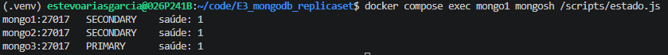

Detívose o nodo primario mediante o comando:

`docker compose stop mongo3`

Consultamos o estado desde Mongo1 repetindo a seguinte orde cada poucos segundos:

`docker compose exec mongo1 mongosh /scripts/estado.js`

Aos **3,7 segundos**, Mongo1 foi elixido automaticamente como novo primario.

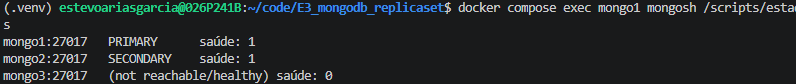

A continuación, conectámonos ao replica set e inserimos unha nova ficha na base de datos `albergues`. Antes de inserila, cerciorámonos de que Mongo1 é realmente o nodo primario mediante un `db.hello()`. Como vemos, Mongo1 é realmente o nodo primario.

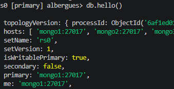

Agora sí, inserimos a nova ficha e comprobamos que aparece con `db.fichas.findOne`. operación realizouse correctamente, demostrando que o sistema continúa permitindo escrituras tras a caída do primario.

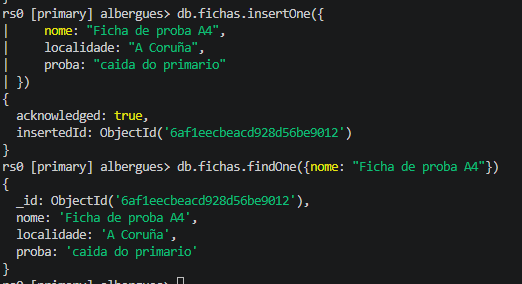

#### Recuperación do antigo primario

Reiniciamos o nodo Mongo3 mediante o comando:

`docker compose start mongo3`

Comprobamos que os tres nodos estaban activos: Mongo1 continuaba como primario e Mongo2 e Mongo3 como secundarios.

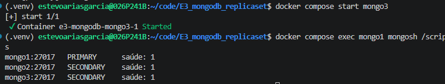

Finalmente, consultamos directamente Mongo3 para comprobar se recibira a ficha inserida durante a súa caída. O documento estaba dispoñible, confirmando que a replicación dos datos se realizou correctamente.

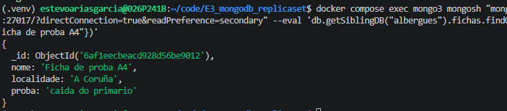


## 5. Caída de dous nodos

Detivemos Mongo2 e Mongo3, deixando só Mongo1 activo: `docker compose stop mongo2 mongo3`

Ao consultar o estado, comprobamos que Mongo1 permanecía como SECONDARY e non había ningún PRIMARY.

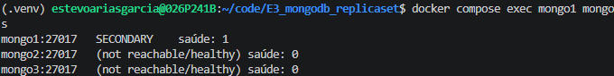

#### Proba de escritura

Intentamos realizar unha inserción, pero fallou porque non había ningún nodo primario dispoñible. Ao conectarnos directamente a Mongo1, recibimos o erro NotWritablePrimary.

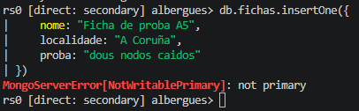

#### Probas de lectura

Coa preferencia de lectura por defecto (primary), tampouco foi posible establecer a conexión co replica set.

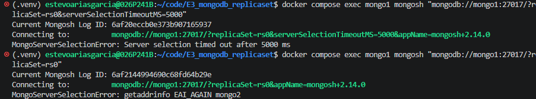

Forzamos entrar no replicaset co primario como server preferencial.

`docker compose exec mongo1 mongosh "mongodb://mongo1:27017/?replicaSet=rs0&readPreference=primaryPreferred&serverSelectionTimeoutMS=10000"`

Deste xeito puidemos consultar as fichas desde Mongo1, que estaba en estado SECONDARY. Aplicamos os scripts que cambian a configuración da lectura a "PrimaryPreferred", onde non é obligatorio que a lectura a realice o primario se ben segue sendo preferencial:

```
use albergues
db.getMongo().setReadPref("primaryPreferred")
db.fichas.find()
```
Como vemos na seguinte captura, o nodo secundario xa pode ler as fichas.

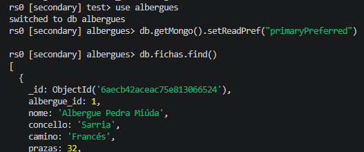

E como se pode ver, o modo de lectura está en *PrimaryPreferred*. 

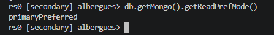

Restauramos os dous nodos que caeron e todo volve á normalidade. A replica set recupérase.

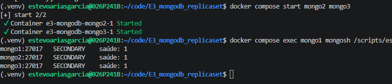

## Cuestións

#### 1. Por que non hai primario aínda que un nodo funciona?

Para que haxa un primario, ten que haber unha maioría de nodos que estén en disposición de elixir un novo primario. Se só hai un nodo de tres que había, nunca se pode chegar a esa maioría.

#### 2. Por que a lectura falla ou funciona segundo a preferencia de lectura?

Por defecto, a lectura está configurada para que a faga o primario, por iso non deixaba entrar no replicaset e houbo que botar uso do script `mongodb://mongo1:27017/?replicaSet=rs0&readPreference=primaryPreferred&serverSelectionTimeoutMS=10000`. No momento en que cambias o modo a PrimaryPreferred, xa non é exclusiva a lectura do nodo primario, tamén a pode facer o secundario, e iso é o que ocorreu.

#### 3. Que pasaría se o replica set tivese 5 nodos e caesen 2?

Non daría erro porque quedarían 3 nodos dispoñibles que poderían deliberar a promoción a primario dun dos 3 nodos restantes.


-------------------------------------------------------------------


# E3. Garage: almacenamento de obxectos | Parte B

## 1. Formación do clúster (B1)

Copiouse o env.example, creouse un segredo de 64 caracteres, arrancouse o docker compose.

Consultouse o estado do nodo 1, conectáronse os nodos 2 e 3 mediante os seus identificadores e comprobouse que os tres nodos aparecían no estado do clúster.

## 2. Definición do layout (B2)

Asignouse a cada nodo unha zona distinta e unha capacidade de 1 GB. Revisouse a configuración co comando layout show, aplicouse co comando layout apply --version 1 e comprobouse con garage status que os tres nodos tiñan a súa zona e capacidade asignadas.


## 3. Bucket, clave e primeiros datos (B3)

Creouse o bucket albergues-docs e a clave de acceso e3-clave, á que se lle concederon permisos de lectura, escritura e propiedade sobre o bucket.

A continuación, instalouse a biblioteca boto3 e cargáronse 20 documentos de 512 KB cada un. A operación completouse correctamente en aproximadamente 2 segundos.


A verificación posterior confirmou que os 20 obxectos se puideron descargar correctamente e que ningún presentaba corrupción.

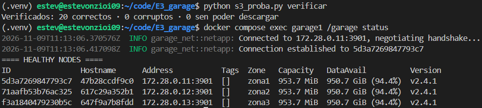

## 4. Cae un nodo
Paramos o nodo 3 e verificamos os arquivos. Como vemos, só se puideron descargar 17 de 20 pola caída dese nodo.


A subida dos 5 arquivos pódese facer sen problema.


Tras a caída do nodo, o cluster marca o nodo 3 como nodo fallido, mentres que os nodos 1 e 2 están saudables.


## 5. Caen dous nodos
Paramos o nodo 2 e tratamos de verificar o nodo 1. Esta vez da erro porque 1 só nodo non pode formar unha maioría. Os arquivos non puideron ser descargados.


Arrancamos de novo os nodos 2 e 3. Como vemos, os arquivos agora sí que puideron ser descargados e o estado dos 3 nodos volve a ser saudable.


### Interpretación do quorum

##### Garage: 

Replica os datos entre os tres nodos. Con dous deles activos puidemos subir algúns documentos, pero algunhas lecturas fallaron (3 de 20). Cun único nodo activo en cambio non se puideron completar as descargas.

##### MongoDB Replica Set: 

Necesita unha maioría dos membros votantes para elixir e manter un Primary. Nun conxunto de tres membros, esa maioría é de dous. Cun só membro non se pode elixir un Primary.

##### Redis Sentinel: 

Os Sentinel supervisan os nodos Redis e utilizan quórum e maioría para autorizar un novo servidor principal. Os sentinel comunícanse entre sí e escollen a promoción dunha réplica.

## 6. Perda dun disco

Simulouse a perda do disco do nodo 3 e a súa substitución por un volume novo e baleiro, mantendo o volume de metadatos para conservar a identidade do nodo.

Antes da eliminación, comprobouse o tamaño que ocupaba o volume do nodo 3:


Despois detívose o nodo 3 e eliminouse o seu volume de datos, mantendo intacto o volume de metadatos. Volveuse a comprobar o tamaño e, como se pode ver, pasou de 10,3 MB a tan só 4 KB.


#### Pequena incidencia

Inicialmente, o nodo non puido arrancar porque Garage non atopaba o ficheiro identificador `garage-marker` no novo volume. Grazas a que conservamos os metadatos, puidemos recuperar o identificador do disco anterior e restaurar o ficheiro marcador. 

O nodo 3 puido arrancarse e conectarse cos outros nodos. Comprobouse se dende este nodo tiñamos acceso aos arquivos. Observouse que sí que tiñamos ese acceso.


Despois executouse o seguinte comando para ordenar a reparación dos bloques: 

`docker compose exec garage3 /garage repair --yes blocks`

Tras a execución, esperamos que o volume da datos do nodo 3 volva a ter 10,3 MB. Comprobouse que así era:

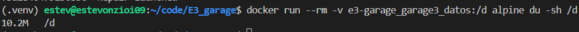

## 7. Cuestións

#### Cál e o espazo que ocupan 300 GB de documentos en: 1. Garage 3 replicacións e 2. erasure coding 4 + 2. Cántos fallos tolera cada un

- Garage | Espazo: Como son 3 réplicas ocupa 300 MB x 3 = 900 MB. 
- Garage | Tolerancia a erros: Pode perder unha copia menos ca o número de réplicas, neste caso 3-1 = 2 copias.  
- Erasure | Espazo: Contén 4 fragmentos de datos e 2 de paridade (de redundancia). Como teñen todos o mesmo peso e o conxunto de datos ocupa 300 MB, podemos saber que os 2 fragmentos extra de paridade ocupan 150 MB, para un total de 450 MB.  
- Erasure | Tolerancia a erros: Pode tolerar ata a desaparición de 2 fragmentos de datos, xa que se poden volver a xenerar a partir dos fragmentos de paridade.

#### Para qué serve o manifesto .json da s3_proba.py. Qué erros detecta que Garage non é capaz.

O manifesto garda un rexistro dos obxectos subidos pola proba e información sobre a súa pegada (o hash). A vantaxe fronte a Garage é que permite detectar os cambios que se producen nos ficheiros, tales como modificacións, delecións ou insercións.

#### A importancia de gardar as copias en zonas distintas

A resiliencia é moito maior cando as copias están en zonas de dispoñibilidade distintas. Cando se produce unha caída dun servidor ou servidores nunha zona, as réplicas poden verse todas afectadas se están nesa zona; sen embargo, se están dispostas en zonas diferentes non se ven afectadas e permiten a preservación dos datos.
